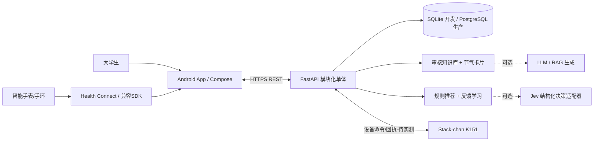
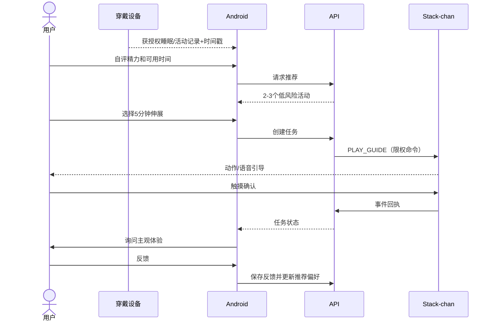

# 时宜 ShiYi · 项目架构设计 V0.1

## 0. 设计目标与边界

- 比赛完整闭环：**了解状态 → 提供选项 → 用户行动或选择 → 反馈调整**。
- 四类知识库：中医药文化常识、药食同源、合理用药、现代健康科普。
- 节气内容卡片和地域性体验为产品特色；AI 不代替医疗诊断。
- Stack-chan 是桌面实体终端，**不是**符合赛题要求的智能穿戴替代品。
- 分开记录真实数据、用户自评、模拟数据；禁止将心率直接解释为情绪或疾病。

## 1. 系统分层

## 2. 客户端和设备责任

| 模块 | 负责 | 不负责 |
| --- | --- | --- |
| Android | UI、授权、状态汇总、历史回顾、离线缓存 | 在安装包内保存 AI 密钥 |
| 穿戴接入 | 获得授权的数据、采集时间、来源和缺失标记 | 推断心理疾病 |
| Stack-chan | 表情、动作、语音、触摸确认 | 医学判断、未经授权全天录音 |
| API | 鉴权、任务编排、个性化推荐、审核问答 | 无审核的处方建议 |
| 知识库 | 证据可追溯的四类内容、地域与节气分类 | 将民俗宣称为有效治疗 |
| Jev | 非医疗意图路由、活动排序与提醒选择 | 药物禁忌安全终裁 |

## 3. 核心数据模型（后续实现）

`User`、`Device`、`Consent`、`HealthObservation`、`CheckIn`、`ActivityCatalog`、`Recommendation`、`ActivitySession`、`ExperienceFeedback`、`KnowledgeCard`、`SeasonTheme`。

`HealthObservation` 应保存 `observed_at`、`recorded_at`、`source`、`is_demo`、`missing_reason`，不能用缺失值臆造健康结论。

`KnowledgeCard` 应保存 `category`、`source_url`、`reviewed_at`、`review_status`、`applicability`、`safety_notes`。

## 4. 活动闭环

## 5. 后端模块与 MVP API

当前实现：`GET /api/v1/health`、`GET /api/v1/seasons/current`（固定演示卡）、`POST /api/v1/recommendations`（规则演示）、`POST /api/v1/activities/feedback`（SQLite 持久化、开发身份隔离）。

未来按领域划分：`identity`、`consent`、`state`、`seasons`、`knowledge`、`recommendations`、`activities`、`devices`。

不要在第一周上微服务、Kubernetes、复杂消息队列或全天摄像头监控。

## 6. Stack-chan 安全协议

建议命令：`SET_EXPRESSION`, `SPEAK_TEXT`, `PLAY_GUIDE`, `SHOW_TIMER`, `MOVE_HEAD_PRESET`, `SET_LED_PRESET`, `CANCEL_TASK`。

每条命令包含 `schema_version`、`command_id`、`correlation_id`、`device_id`、`type`、`payload`、`expires_at`；回执包含事件 ID、发生时间及对应命令。执行必须幂等、参数白名单、动作边界、鉴权和超时；正式联网要求 TLS。

本地设备命令与回执通过 REST 模拟，当前仅允许 SET_EXPRESSION；设备身份为独立开发令牌。MCP 只读工具通过 stdio 接入桥接器。详细边界见 [INTEGRATION.md](INTEGRATION.md)。硬件协议、真机 AI 工具调用、摄像头与穿戴数据均**尚未在代码联调中验证**。

## 7. AI 推荐与安全

1. `RuleGate`：用户授权、勿扰时间、禁用活动、医疗边界。
2. `CandidateGenerator`：审核后活动库。
3. `Ranker`：首版规则；后续 Jev 或个性化模型。
4. `Explainer`：简单、明确、不夸大因果的理由。
5. `FeedbackLearner`：关注接受、完成、主观体验及探索意愿。

医学/药学问答必须检索可信来源。对于药品真伪仅给官方核验途径，不由 AI 照片判断真伪。未审核卡片不进入公开内容。

## 8. 团队里程碑

| 阶段 | 交付 | 验收 |
| --- | --- | --- |
| M0 | 组织仓库与 CI | PR 触发测试，协作规则明确 |
| M1 | Android 主题首页 + API | 本地静态界面可运行，演示数据标识 |
| M2 | Stack-chan 实机接入 | App → API → 设备动作 → 回执 |
| M3 | 穿戴数据 | 真实读取记录、权限、时间、来源 |
| M4 | 完整活动反馈 | 完成/拒绝/超时可回传，规则可复现 |
| M5 | 知识库、Jev 对比与试用 | 有量化指标和用户反馈 |

## 9. 待团队确认

- Stack-chan 精确型号和固件基础；是否必须保留官方固件。
- Wear OS 还是其他品牌穿戴设备、手机 OS 版本。
- 是否允许机器人与手机仅在同一局域网；还是需要跨公网访问。
- AI 云端预算、用户健康数据外发范围、内容审核人。
- Android、后端、嵌入式、设计的负责人。

参考：https://docs.m5stack.com/en/StackChan · https://developer.android.com/health-and-fitness/health-connect
